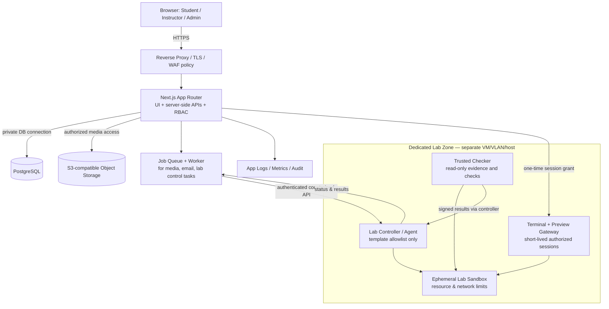
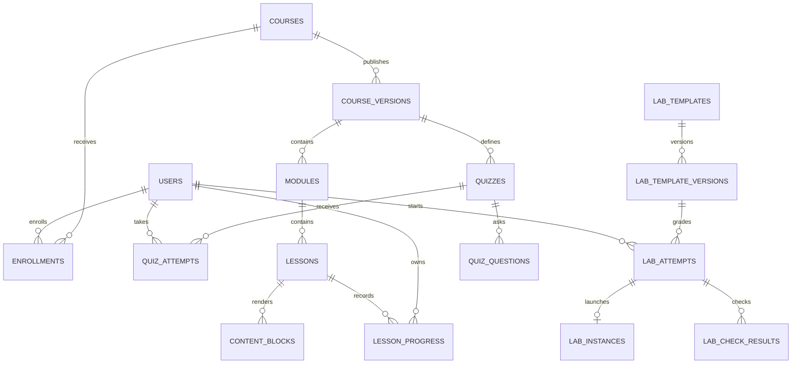

# IT Engineering Academy — Hybrid LMS Architecture & MVP

**Status:** Architecture proposal / implementation blueprint — not a deployed application  
**Date:** 21 November 2026  
**Intended deployment:** Self-hosted; initial single owner, designed to add instructors and learners  
**Languages:** Arabic RTL + English LTR; manually authored content translations

## 0. Executive decision

Build a **modular monolith LMS** and a **separately isolated lab execution plane**. The LMS must remain usable and fully testable with **Guided Labs** while the real lab runner is absent. Add a small, tightly scoped **Real Lab Pilot** after LMS release gates pass. Do not put Docker socket, hypervisor credentials, shell execution, or Kubernetes cluster-admin permissions in the Next.js web application.

**Hybrid means two first-class lab modes:**
- `GUIDED`: instructions, downloadable starter files, checkpoints, manually provided evidence and/or external validation. Never label manually ticked work as system-verified.
- `REAL`: predefined, versioned template, an isolated ephemeral environment, browser terminal, server-side checks, expiration and cleanup.

**First content:** Prometheus & Grafana (per the existing master prompt); validate reusable course builder by creating an unrelated Linux Administration course entirely from the browser. NGINX is a strong candidate for the first **real** lab pilot because it requires fewer host privileges than Docker/Kubernetes administration labs.

## 1. Scope and design principles

### In scope
- Public course catalog and course detail pages.
- Secure accounts, roles: `OWNER`, `ADMIN`, `INSTRUCTOR`, `STUDENT`.
- Browser-only course authoring: categories, courses, modules, lessons, content blocks, media, labs and quizzes.
- Arabic/English interface and independently authored Arabic/English course text.
- Course draft, preview, publish, immutable version snapshots, and learner progress across devices.
- Bookmarking, lesson and quiz completions, lab attempts and dashboard metrics.
- Guided labs usable with local/external VMs.
- Optional later browser terminal with one trusted, isolated lab template and automated validation.
- Audit trail, backup/restore, monitoring, secure defaults and reproducible deployment.

### Out of scope for initial LMS MVP
- Public untrusted multi-tenant shell hosting.
- Arbitrary uploaded Docker Compose/Kubernetes YAML executed as privileged infrastructure.
- Per-user nested Kubernetes or OpenShift clusters.
- Automatic extraction of all legacy HTML into perfect structured content.
- AI grader, video hosting at scale, payment processing, badges/certificates and mobile apps.

## 2. Architecture (C4-style container view)



**Trust rule:** No direct student connection to hypervisor management, orchestrator API, lab worker SSH, database, or Docker daemon. The application API does not receive arbitrary shell strings to execute on its host.

### Deployable units
1. `web`: Next.js application: server components, course player, course authoring, API routes, auth/RBAC.
2. `postgres`: persistent business data; not public.
3. `object-store`: S3-compatible files. Use a local dev implementation and a supported production storage provider; private media require signed, short-lived access.
4. `worker`: asynchronous operations and retries; store durable jobs and idempotency keys. Add Redis only if choosing a Redis-backed queue; do not create a second datastore without a concrete need.
5. `lab-controller`: only in later Real Lab Pilot, deployed in a separate trust zone.
6. `lab-sandbox`: transient environment provisioned for a lab attempt, never on the production LMS node.
7. `terminal-gateway`: authenticated short-lived WebSocket PTY bridge; separate from Next.js process, no unrestricted host access.
8. `grader`: approved checks external to the student's writable environment.

## 3. Recommended technology decisions

| Layer | Choice | Reason / rule |
|---|---|---|
| Application | Next.js App Router + React + TypeScript | One codebase, server-side permission boundary; deployment to Docker is documented. |
| Package/runtime | pnpm, supported Node LTS (pin and verify) | Deterministic builds. |
| UI | Tailwind + shadcn/ui or accessible equivalent | Fast, coherent design system. |
| Content editor | Tiptap + allowlisted JSON block schemas | Safe reusable lesson content; no raw uploaded HTML/JS execution. |
| Localization | next-intl | `/ar` and `/en`, RTL/LTR including authored content. |
| Database | PostgreSQL + Drizzle ORM migrations | Relational integrity, published snapshots, attempts. |
| Auth | Better Auth + server-side policy layer | Login, secure sessions; enforce custom LMS roles and ownership checks on every sensitive API. |
| Media | S3-compatible interface | Portable self-hosted media and lab artifacts. |
| Schema validation | Zod | Server-side input contracts. |
| Testing | Vitest + Playwright | Unit, integration, end-to-end and permission tests. |
| Reverse proxy | NGINX or Caddy | TLS termination and safe request limits. |
| Real lab runner | Dedicated Linux VM initially; upgrade to isolated VMs/containers with controls | Minimize control-plane complexity and failure blast radius. |
| Terminal | xterm.js browser component + authenticated PTY WebSocket proxy | Interactive terminal without exposing runner management. |
| Monitoring | Prometheus + Grafana + structured logs | Dogfood academy's own monitoring courses. |

Do not hardcode library version numbers in a design document; check current official compatibility when bootstrapping, pin exact versions in lockfile.

## 4. User experience and pages

### Public
`/`, `/ar/courses`, `/en/courses`, `/courses/[slug]`, login, register, about.

### Student
- `Dashboard`: enrolled courses, next lesson, pending labs, recent attempts.
- `My Learning`: course progress, resume exactly where stopped.
- `Course Player`: lesson navigation + content blocks + code copy + diagrams.
- `Labs`: Guided / Real mode explicitly displayed, task steps, hints, attempts, results.
- `Quiz`: question-by-question, submit, score and rationale.
- `Profile`, bookmarks, per-course history.

### Admin / Instructor
- `Overview`: courses, enrolled users, completions, attempts, running lab sessions.
- `Course Builder`: course > modules > lessons > content blocks; preview, draft, publish.
- `Question Bank`: translated questions with versioned answers/explanations.
- `Lab Builder`: Guided Lab content and downloadable assets; later select approved Real Lab template.
- `Media`, `Users`, `Roles`, `Settings`, `Audit Logs`.

### Example course player layout

```text
+------------------------------------------------------------------------+
| IT ENGINEERING ACADEMY          Search        AR/EN   Profile           |
+-----------------------+------------------------------------------------+
| Prometheus & Grafana  | Lesson: Scrape Targets                         |
| 01 Fundamentals       | Breadcrumb / duration / lesson status          |
| 02 Installation       | Explanation and architecture diagram           |
| 03 Exporters          | Code block with copy                            |
| 04 PromQL             | Practice panel                                 |
| 05 Grafana            | [Guided Lab] or [Real Lab]                      |
| Progress 42%          | [Start] [Validate] [Reset] [Hints]             |
|                       | Quiz / Next lesson                              |
+-----------------------+------------------------------------------------+
```

## 5. Content model: not an HTML-file viewer

Each Course has localized metadata and an ordered tree of `Modules -> Lessons -> ContentBlocks`.

Supported safe content blocks:
- `rich_text`, `heading`, `callout`, `code`, `terminal_output`, `image`, `diagram`, `table`, `tabs`, `downloadable_asset`, `knowledge_check`, `lab_reference`, `quiz_reference`, `video_embed` (allowlisted providers only).
- Every content block stores `type`, `schema_version`, and validated JSON `payload`.
- Author publishes a **read-only CourseVersion snapshot**. Existing learners should not silently lose progress when the author revises text or answer keys.
- Stable logical identifiers for lessons/questions plus revision identifiers enable explicit progress migration decisions.
- Mark simulated widgets plainly `Simulation` and true executed content `Real Lab`.

Legacy files handling:
- Preserve `prometheus-grafana-course-bilingual.html`, `nginx-course.html`, `nginx-course-en.html` as **read-only source material** in `/reference` (or protected asset store), not directly executable student pages.
- Curate one module at a time; separately migrate prose, code blocks, diagrams, guided exercises and questions.
- Review generated content, links, translation and lab correctness before publishing.
- A runtime HTML iframe that executes arbitrary legacy JavaScript is not a safe core authoring model.

## 6. Core data model



Minimum tables and important fields:

| Entity | Fields / behavior |
|---|---|
| `users` | ID, email, status, auth provider fields via auth adapter. |
| `role_assignments` | user ID, role, scope (global or assigned course), dates. |
| `categories` | slug, localized name, sort. |
| `courses` | ID, owner ID, slug, current published version, visibility, status. |
| `course_versions` | course ID, version, published at, immutable content reference. |
| `course_translations` | Arabic/English title, descriptions, metadata. |
| `modules`, `lessons`, `content_blocks` | version reference, order, localizations and validated typed payloads. |
| `enrollments` | user, course, enrolled version/upgrade choice, state. |
| `lesson_progress` | user, stable lesson ID, version, completion, updated at. Unique scope prevents duplicate progress. |
| `quizzes`, `question_versions` | translated questions, correct answers, explanation and scoring snapshot. |
| `quiz_attempts`, `quiz_answers` | attempt IDs, copied question revision, score, graded at. |
| `lab_templates`, `lab_template_versions` | mode, allowed prebuilt image/manifest, resources, TTL, grader version. |
| `lab_attempts` | user, lesson, template version, status, grade, timestamps, retries. |
| `lab_instances` | attempt, lab resource opaque ID, provision/start/expire/destroy state. No raw credentials. |
| `lab_check_results` | criterion key, pass/fail, evidence metadata, checker build ID. |
| `assets` | private object key, checksum, content type, owner, authorization scope. |
| `audit_logs` | actor, action, target, timestamp, result, source metadata. |

All tenant/course ownership and publication visibility checks are enforced in queries/server APIs, not merely by hiding buttons.

## 7. Lab modes: contracts and life cycles

### Guided Lab (part of LMS MVP)

**Template fields:** prerequisites, expected duration, requirements, steps, expected outputs, starter files, hints, checkpoints, optional evidence submission, completion policy, solutions visibility.

**Flow:**
1. Learner opens the lab and verifies prerequisites.
2. Learner downloads or copies a vetted starter project and performs steps on local/external infrastructure.
3. Learner marks tasks done or provides proof; app stores attempts and timestamps.
4. The UI distinguishes `Self-reported`, `Instructor-reviewed` and `System-verified` completion. Never infer automatic verification from a checklist.

### Real Lab (phase 1.1/pilot, after Guided MVP)

**Template fields:** versioned signed image digest or VM snapshot ID, resource envelope, boot script controlled by admin, ingress/egress allowlist, maximum runtime, health check, grader ID and exact acceptance criteria, maximum attempts, cleanup rules.

**State machine:**
`REQUESTED -> QUEUED -> PROVISIONING -> READY -> RUNNING -> VALIDATING -> PASSED/FAILED -> STOPPING -> DESTROYED`.
Alternate terminal states: `PROVISION_FAILED`, `EXPIRED`, `CANCELLED`, `CLEANUP_FAILED` (requiring alert/manual reconciliation).

**Flow:**
1. Authenticated student clicks Start. Backend validates access, template availability, quota, active-session limit and course version.
2. Create one immutable attempt and a queued provision job with an idempotency key.
3. Internal lab controller provisions a sandbox from an **admin-approved** template only.
4. Health check confirms READY; issue expiring one-use terminal/session grant scoped to this attempt.
5. Student connects to terminal through WebSocket gateway; optional preview served through authorized reverse proxy.
6. Validate calls a **pre-approved external checker**. Return criteria, evidence metadata and score to app; never trust the student's self-supplied output.
7. Stop/reset/TTL expiration destroys instance and revokes grants; cleanup job retries, with reconciliation and alerts for orphans.
8. DB retains **attempt metadata and outcomes**, not lab root secrets or host-level privileges.

**Real lab example: NGINX reverse proxy**
- Prepackaged sandbox with NGINX and two tiny test upstreams.
- Student configures upstream proxy behavior within the lab filesystem.
- Checker verifies effective config, routing to expected backend and response; no access to host shell required.
- Pass only when real checker succeeds; show useful failures, not hidden answer text.

**Kubernetes/OpenShift later:** Kubernetes student access and cluster-admin exercises require much stronger separation. Use dedicated disposable cluster/VM per learner for high-privilege tasks; Pod restrictions and NetworkPolicies alone are not an adequate substitute for VM isolation with adversarial/untrusted workloads. OpenShift/OKD requires a separate realistic capacity plan; not part of the MVP.

## 8. Security architecture and network zones

```text
Internet / Trusted Student LAN
         |
         v
[DMZ / App Zone] -- HTTPS only -- LMS (web/API)
         |                         |
         |                         +--> [Private Data Zone] PostgreSQL / Object Storage
         |
         +--> [Internal Job/Control API] --> [Isolated LAB Zone]
                                                    |
                                         authorized session gateway
                                                    |
                                         ephemeral user environment

Never route LAB Zone to: Domain Controllers, hypervisor management,
backup network, production VLANs, database subnet or cloud metadata endpoints.
```

Recommended boundary controls:
- Dedicated Lab VM/host or, for multi-user high-risk labs, per-user VM isolation; no lab containers on app/DB VM.
- Deny-by-default egress and ingress; explicitly allow only necessary DNS, package mirrors or lesson endpoints. Carefully control access to link-local/metadata and internal RFC1918 networks.
- No host filesystem mounts, Docker socket, privileged containers, host network/PID, container runtime admin tokens, untrusted CI secrets or cluster admin service accounts in lab workloads.
- Drop Linux capabilities, run as non-root, enforce seccomp/no-new-privileges, read-only base filesystem where compatible; cap CPU, memory, PID, disk and runtime.
- For Kubernetes labs, validate actual network-policy enforcement in the chosen CNI and use `restricted` Pod Security admission when feasible. Real cluster administration exercises need dedicated ephemeral clusters instead.
- Only internally registered templates and checkers; signed/reviewed image references; no arbitrary commands submitted to the runner control API.
- HTTPS, secure/HttpOnly cookies, strong password reset/verification, CSRF protections, object-level RBAC, upload size/content validation, audit logs, key rotation, backups and access reviews.
- WebSocket terminal authenticates **before upgrade** and continuously respects instance ownership, expiry, and revocation; never expose raw node ports publicly.
- Separate production and lab credentials; no production data in sandbox; enforce session cap, quotas, TTL and periodic orphan cleanup.

Key references:
- Docker daemon hardening: https://docs.docker.com/engine/security/protect-access/
- OWASP Docker Security Cheat Sheet: https://cheatsheetseries.owasp.org/cheatsheets/Docker_Security_Cheat_Sheet.html
- Kubernetes Pod Security Standards: https://kubernetes.io/docs/concepts/security/pod-security-standards/
- Kubernetes NetworkPolicy: https://kubernetes.io/docs/concepts/services-networking/network-policies/
- Kubernetes multi-tenancy: https://kubernetes.io/docs/concepts/security/multi-tenancy/

## 9. Initial infrastructure and capacity assumptions

**Option A: Owner-only self-host pilot**
- **VM 1 — Academy App + DB + private storage:** starting estimate 4 vCPU, 8–12 GB RAM, 100 GB disk (depending on assets), Ubuntu Server LTS, Docker Compose. DB durable volume, off-host backups.
- **VM 2 — Isolated Lab Worker:** starting estimate 8 vCPU, 16–32 GB RAM, 100–200 GB SSD, dedicated firewall subnet. This is a *provisional starting envelope* for a couple of small NGINX/Prometheus labs, **not** a measured concurrency guarantee.
- Network: only app-gateway-to-controller control traffic and scoped learner gateway traffic; deny all other lateral reachability.
- App domain and TLS can be added from a trusted reverse proxy; use internal DNS during development.

**Option B: Instructor + students**
- Move PostgreSQL and object storage to their own VM/service as demand requires; introduce queue workers and separate gateway replicas.
- Capacity plan from measured **idle + per-active-lab** resource use: `(baseline + max_concurrent_labs × per_lab_resource + headroom)` for CPU, RAM, disk, ingress/egress.
- Cluster labs require dedicated capacity, templates, cleanup accounting and isolation model. Do not promise arbitrary concurrent Kubernetes/OpenShift labs on the initial worker VM.

**Operational requirements:** PostgreSQL PITR/WAL strategy if needed, daily full backup, test restore, protected object store backups, monitor queue depth/failed jobs, active lab count, TTL cleanup, application error rate, login failures and disk usage.

## 10. Course catalog and teaching paths

```text
IT Engineering Academy
├── Linux & Operating Systems
│   ├── Linux Administration
│   └── Shell Scripting
├── Containers
│   ├── Docker
│   └── Docker Compose
├── Orchestration
│   ├── Kubernetes
│   └── OpenShift / OKD
├── Web & Proxy
│   └── NGINX
├── Observability
│   ├── Prometheus
│   └── Grafana
├── Source Control & CI/CD
│   ├── Git & GitHub
│   └── CI/CD Pipelines
└── Projects
    └── Deploy and Monitor a Production-like Web App
```

Suggested cross-course capstone (later): configure NGINX in front of a containerized app, collect metrics with Prometheus, visualize with Grafana, store code and workflows in GitHub, eventually deploy on Kubernetes. Mark optional prerequisites to keep each course independent.

### First publishing increments
1. **Prometheus & Grafana:** convert *one vetted module at a time* from existing HTML; add Guided lab and question bank. The entire legacy HTML is not assumed migration-ready.
2. **Linux Administration:** create entirely in Admin UI to demonstrate course builder generality, with no edits to source code.
3. **NGINX:** import curated AR/EN content as structured lessons, add the first approved Real Lab pilot.
4. Only after that: Docker, Kubernetes, OpenShift, Git/GitHub etc.

## 11. Delivery plan: gated, testable slices

### Phase 0 — Decisions/repository
- Confirm scope and threat model, initial environment and network segmentation.
- Scaffold repository structure and `AGENTS.md`, `VISION.md`, `ARCHITECTURE.md`, `DATA_MODEL.md`, `ROADMAP.md`, `PLANS.md`, `ACCEPTANCE_TESTS.md`.
- Gate: explicit decisions, version checks and documented local startup paths.

### Phase 1 — Runnable platform foundation
- Next.js/TypeScript, bilingual shell `/ar` and `/en`, responsive navigation, Postgres migrations, Docker Compose, health/readiness, CI, lint/typecheck/build/test.
- Gate: fresh clone starts, migrations succeed, health responds, smoke tests pass.

### Phase 2 — Authentication/RBAC
- Secure account flow, owner bootstrap, roles and scoped course ownership checks.
- Gate: student cannot reach admin APIs; instructor cannot modify another instructor's course.

### Phase 3 — Generic content authoring
- Categories, course builder, modules/lessons, versioned content blocks, AR/EN editing, private media, preview/publish snapshots.
- Gate: admin publishes a second unrelated course **from UI only**, with no source or DB edits.

### Phase 4 — Student experience
- Catalog, enrollments, course player, bookmarks, progress, lesson completion and resume.
- Gate: student progresses, signs out, signs in elsewhere and resumes; unpublished content remains private.

### Phase 5 — Quizzes + Guided Labs = LMS MVP (v1.0)
- Question bank, translation, scored immutable attempts, Guided Lab authoring, file downloads, manual evidence, analytics, checkpoint progress.
- Gate: real learner completes published course, passes quiz, executes Guided Lab, results persist; misleading 'verified' labels prohibited.

### Phase 6 — First source-based course
- Build and QA Prometheus/Grafana incrementally; add tests for content renderers and AR/EN links; don't mark unfinished modules complete.
- Gate: one **complete** publishable learning path, with real authored content and verified downloads; ability to add an independent course maintained.

### Phase 7 — Secure Real Lab Pilot = Hybrid v1.1
- One approved NGINX real template, dedicated worker VM, controller, terminal gateway, session quotas, TTL, external grader, kill/reset, status/cleanup alerts.
- Gate: create/validate/reset/expire succeeds repeatedly; unauthorized user cannot access another user's lab; controls cannot reach production subnets; orphan cleanup reconciles after simulated crashes.

### Phase 8 — Production hardening + expansion
- Application/security testing, restore drill, resource measurements, rate limits, auditing, admin handover, second real template if justified.
- Gate: operations and security acceptance suite passes before enrolling untrusted external users.

## 12. Test and acceptance matrix

| Test | Expected behavior |
|---|---|
| Auth/RBAC | Student cannot POST to course publish API, even directly via HTTP. |
| Course independence | New Linux course authored/published from browser without DB inserts or code edits. |
| Localization | Arabic uses RTL throughout; English LTR; code blocks stay readable LTR. |
| Draft security | Unpublished course and private media inaccessible to non-authorized users. |
| Publish/versioning | Editing question after student attempt does not change past attempt score. |
| Progress | Progress persists after logout and login from another device/browser. |
| Guided Lab | Downloadable assets authorized; evidence status explicit; checkpoint persists. |
| Real Lab ownership | Student B cannot access Student A terminal or preview (HTTP or WS). |
| Real Lab limit | Quotas and max runtime enforced, including repeated Start requests. |
| Real Lab grading | Tampered client result cannot mark lab completed; trusted checker decides. |
| Real Lab cleanup | Expired/reset lab is destroyed; stale connections revoked; orphan reconciled. |
| Isolation | Lab cannot reach LMS DB, hypervisor, management VLANs or production systems. |
| Recovery | Postgres + object-store backups restore to a clean environment. |
| Observability | Failure and runtime metrics, audit log and alerts show actionable signals. |

## 13. Proposed API boundaries (illustrative, not implemented)

### LMS
```text
GET    /api/courses
POST   /api/admin/courses
PATCH  /api/admin/courses/:id
POST   /api/admin/courses/:id/publish
GET    /api/courses/:slug/versions/current
POST   /api/courses/:id/enroll
PUT    /api/lessons/:id/progress
POST   /api/quizzes/:id/attempts
POST   /api/quiz-attempts/:id/submit
POST   /api/lab-attempts
GET    /api/lab-attempts/:id
POST   /api/lab-attempts/:id/validate
POST   /api/lab-attempts/:id/stop
```

### Internal lab controller (not exposed to public/student)
```text
POST   /internal/v1/instances/provision     # immutable approved template version
POST   /internal/v1/instances/:id/check     # allowlisted grader
POST   /internal/v1/instances/:id/destroy   # idempotent
GET    /internal/v1/instances/:id/status
```

All endpoints implement authentication, owner/course scope authorization, schema validation, rate limits, idempotency where needed and safe error responses.

## 14. Minimum operational repo layout

```text
it-engineering-academy/
├── app/                         # Next.js localized routes & API
├── src/
│   ├── features/
│   │   ├── identity/
│   │   ├── courses/
│   │   ├── authoring/
│   │   ├── progress/
│   │   ├── quizzes/
│   │   └── labs/
│   ├── db/                       # schema + migrations
│   ├── policies/                 # centralized RBAC
│   ├── content/                  # block schemas/renderers
│   └── lib/
├── services/
│   ├── jobs/                     # only when needed
│   └── lab-controller/           # post v1.0, isolated deployment
├── infra/
│   ├── compose/
│   ├── monitoring/
│   └── lab-templates/            # admin-reviewed, image-pinned
├── reference/                   # legacy HTML, read-only
├── tests/
│   ├── unit/
│   ├── integration/
│   ├── e2e/
│   └── security/
├── docs/
├── AGENTS.md
├── VISION.md
├── ARCHITECTURE.md
├── DATA_MODEL.md
├── ROADMAP.md
├── ACCEPTANCE_TESTS.md
└── PLANS.md
```

## 15. Explicit changes to supplied Codex prompt/roadmap

The supplied `Codex_Master_Start_Prompt.md` and `IT_Academy_Execution_Roadmap.md` correctly prioritize real course authoring and production-quality milestones. Preserve their **Phase 0+1 only** first-execution instruction and core acceptance tests.

**Add:**
- `LAB_ARCHITECTURE.md` containing the two modes, trust boundaries, state machine, resource controls, grader, cleanup and lab privilege classifications.
- `SECURITY_THREAT_MODEL.md`: trust assumptions, actor capabilities, isolation controls, public access readiness.
- `PHASE_REAL_LABS.md`: a separate phase **after** completed Guided Labs, not inside Phase 1.
- Updated `PLANS.md` phase gates and proof from actual tests.
- `labMode` and `completionProvenance` fields in data model; versioned lab attempts and immutable check results.

**No scope creep:** The first Codex execution remains **foundational runnable app**, not a full academy, not 20 courses, and not a raw Docker terminal. Scope should only expand as preceding acceptance gates pass.

## 16. Definition of Done

### LMS v1.0 is done only when:
- Owner signs in securely and creates a course with Arabic/English lessons from UI.
- Owner adds Guided Lab, assessment and files, then previews and publishes.
- Learner enrolls, reads content, completes a Lab checklist, passes quiz and signs out.
- Another login restores progress and previous score.
- Private/draft course access is blocked at the server; backups/restore proven; deployable on owned host.

### Hybrid v1.1 is done only when:
- All v1.0 gates pass **and** a learner can start NGINX Real Lab, use in-browser terminal, validate against external checks, reset/restart safely and get accurate progress.
- Lab resources are isolated, finite, monitored and cleaned up on success, failure and expiry.
- Negative authorization and network-isolation tests pass and are documented.

---

### Verified external architectural references (consulted November 2026)
- Next.js self-hosting: https://nextjs.org/docs/app/guides/self-hosting
- Better Auth roles/org plugin: https://better-auth.com/docs/plugins/organization
- Docker daemon security: https://docs.docker.com/engine/security/
- Kubernetes restricted pod security: https://kubernetes.io/docs/concepts/security/pod-security-standards/
- Kubernetes multi-tenancy: https://kubernetes.io/docs/concepts/security/multi-tenancy/

**Design caveat:** Infrastructure sizes are estimates; the architecture, diagrams, APIs and security controls are proposals. No app, lab controller, Docker setup, VM, grader or end-to-end test has been implemented by this document.
